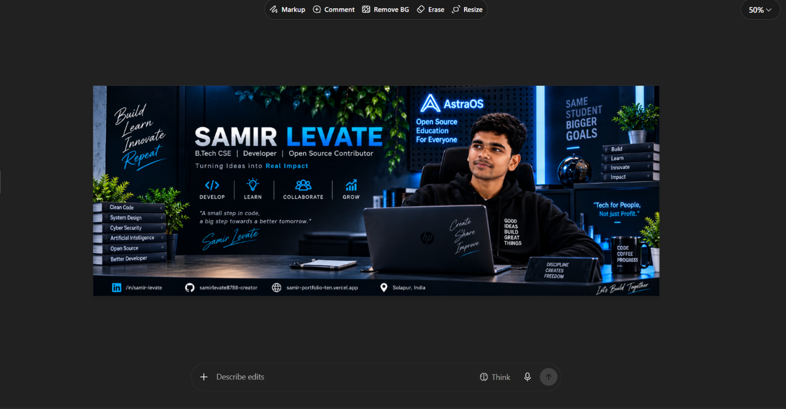
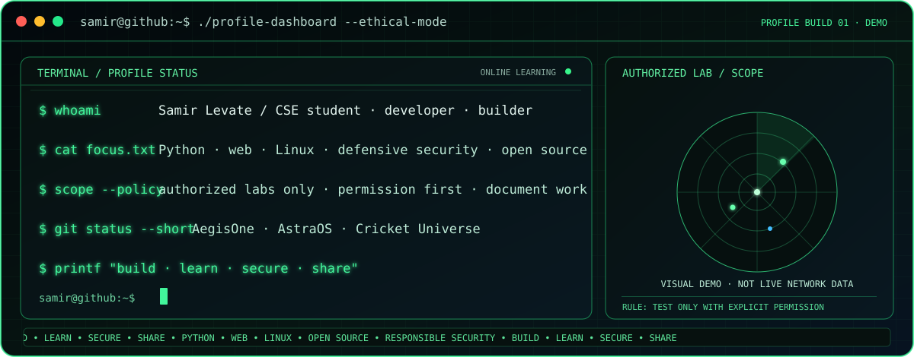
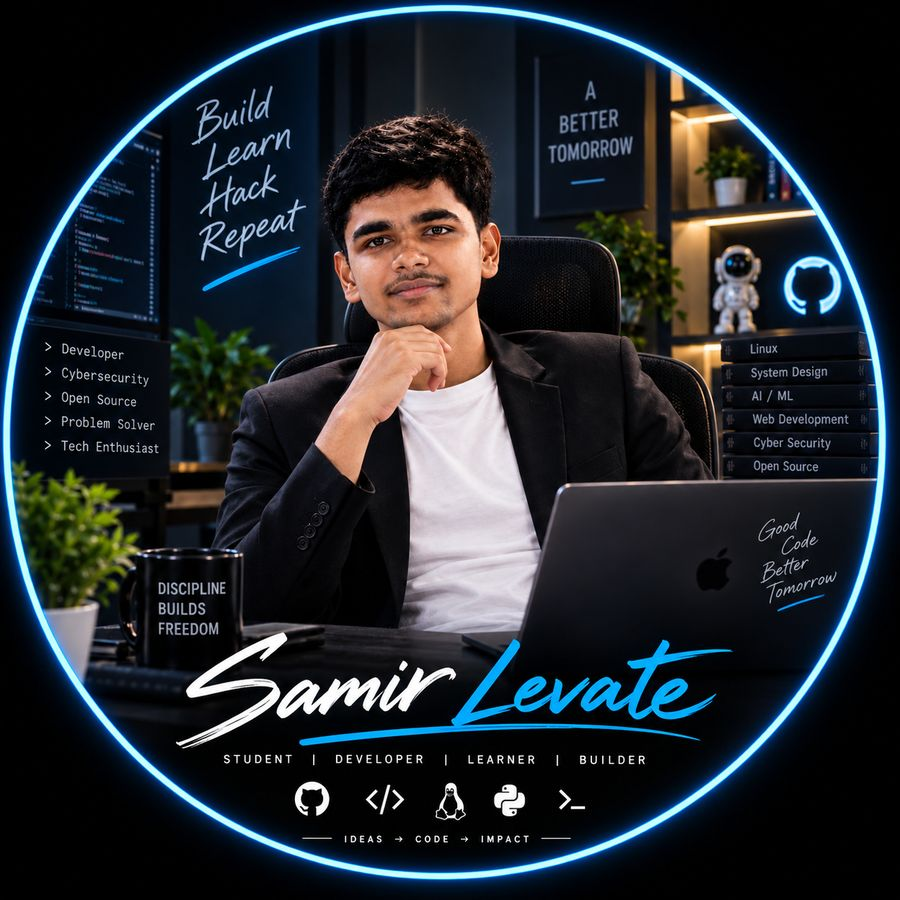

<h1>Samir Levate</h1>

<strong>B.Tech CSE student · Software Developer · Full Stack · AI · Cybersecurity · Systems · Creative Technology</strong>

I learn by building: web applications, Python tools, AI and defensive-security projects, systems concepts, games, and creative digital content.

<table>
  <tr>
    <td align="center"></td>
    <td align="center"></td>
  </tr>
  <tr>
    <td align="center">GitHub profile portrait</td>
    <td align="center">Developer portrait</td>
  </tr>
</table>

---

  
  
  

### `telemetry --public`

  
  

GitHub’s native contribution graph and activity timeline below show the source-of-truth activity.

## `./contributions --animate`

  <picture>
    <source media="(prefers-color-scheme: dark)" srcset="https://raw.githubusercontent.com/samirlevate8788-creator/samirlevate8788-creator/output/github-contribution-grid-snake-dark.svg" />
    <source media="(prefers-color-scheme: light)" srcset="https://raw.githubusercontent.com/samirlevate8788-creator/samirlevate8788-creator/output/github-contribution-grid-snake.svg" />
    
  </picture>

Automatically generated from GitHub contribution activity.

## `whoami`

I’m a B.Tech Computer Science & Engineering student who enjoys turning what I learn into useful, documented projects. My interests include software engineering, web development, defensive cybersecurity, AI, Linux and systems, and open source.
